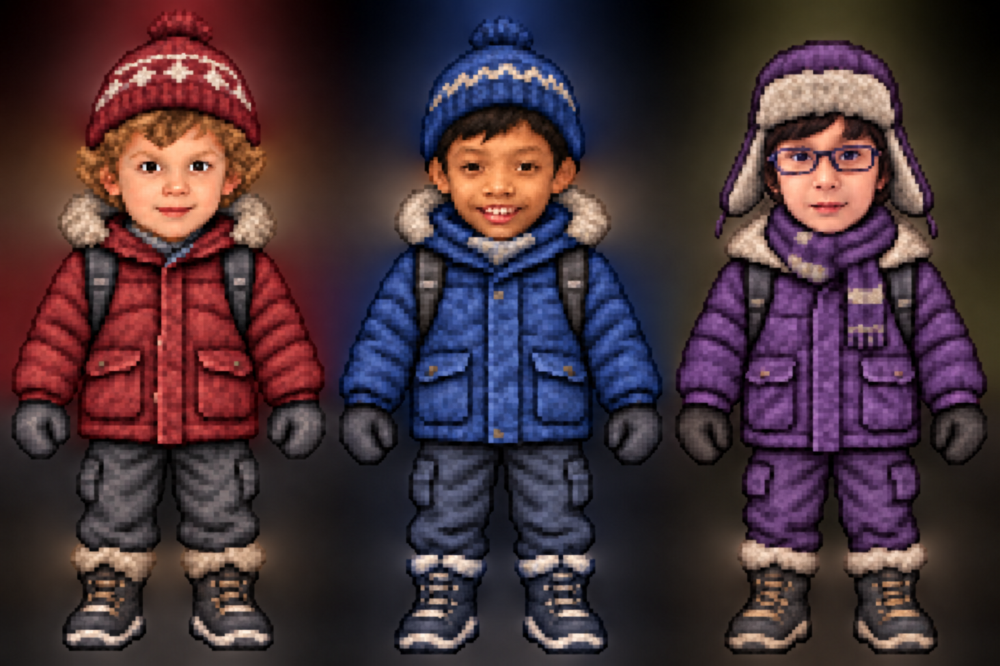
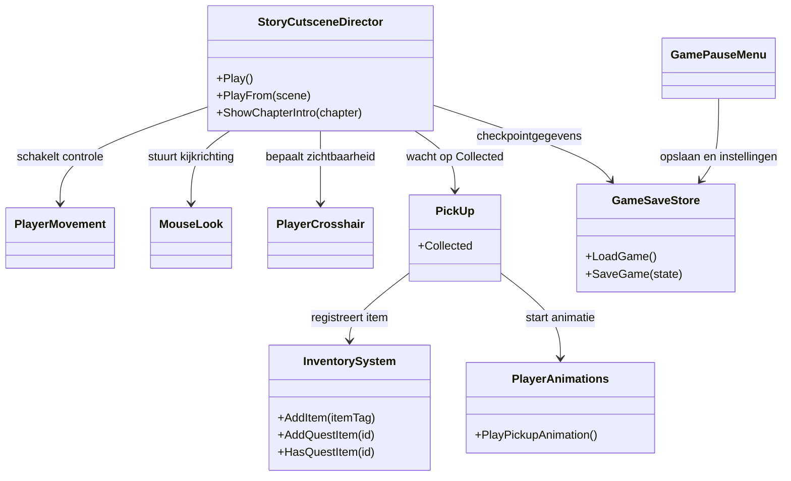

# Never Miss the Bus

Een first-person horrorgame waarin drie vrienden na school de bus missen. Ze nemen de laatste bus, vallen in slaap en worden wakker na een crash. De chauffeur is verdwenen. Zijn bebloede bril vormt de eerste aanwijzing op een zoektocht door een verlaten dorp en een donker bos.

**Status:** prototype in ontwikkeling — geen afgeronde release. De huidige implementatie loopt van de school tot het betreden van een placeholderhuis van de boswachter. Latere gebeurtenissen staan al in het verhaalbestand, maar zijn nog niet volledig speelbaar uitgewerkt.

**Techniek:** Unity 6 (`6000.0.51f1`), C#, Universal Render Pipeline en TextMesh Pro. De game combineert een 3D-omgeving met gepixelde 2D-billboardpersonages.

## Portfolio-overzicht

| Portfolio-item | Beschikbaar bewijs | Status |
| --- | --- | --- |
| Visual sheets | Character-design en sprite-overzichten hieronder | Aanwezig; deels AI-gegenereerde assets |
| Blog posts | Drie ontwikkelposts in deze README | Gedocumenteerd op basis van de implementatie |
| Screenshots | Eerder gedeelde Unity-beelden; nog geen losse bestanden in deze repository | Nog toevoegen als portfolio-selectie |
| Showreel | Voorstel voor opnamevolgorde hieronder | Nog opnemen; geen videobestand aanwezig |
| Technisch ontwerp / class diagram | Systeemoverzicht, diagram en broncodeverwijzingen | Aanwezig |
| Git commits | Bestaande commits met links hieronder | Aanwezig; lokale vervolgwijzigingen zijn niet automatisch gecommit |

## 1. Visual sheets

### Personages en art direction

| Personage | Uiterlijk | Rol |
| --- | --- | --- |
| Mass | Rode winterjas, krullen | Speelbaar hoofdpersonage |
| Aremi | Blauwe winterjas | Vriend |
| Dimash | Paarse winterjas, bril | Vriend |

*Character-sheet, geen gameplay-screenshot. De sprites zijn met AI-beeldgeneratie gemaakt op basis van aangeleverde referenties en vervolgens in Unity geïntegreerd. De winterkleding, pixelstijl en gedempte kleuren ondersteunen de koude horrorsfeer.*

*Iteratiesheet: achteraanzichten worden gebruikt bij weglopen tijdens gameplay. De zittende varianten op de onderste rij zijn na feedback uitgeschakeld. De game gebruikt kleurcorrectie voor de achteraanzichten; deze bronafbeelding toont die shadercorrectie niet.*

De visuele richting bestaat uit koude blauwgrijze mist, warme straatlampen, donkere interieurs en retro-achtige textures. Character-billboards draaien naar de camera; de rugweergave wordt beperkt tot daadwerkelijke beweging van de speler af, buiten dialogen en cutscenes.

## 2. Blog posts / ontwikkellog

### Van cutscene naar first-person busrit

**Probleem:** camera-overgangen en automatisch geplaatste personages konden het beeld in stoelen of buiten de bus zetten. Ook moest de speler zelf naar zijn vrienden kunnen lopen.

**Aanpak:** de originele Player-camera blijft het uitgangspunt voor de bus. Lopen en praten zijn gescheiden: tijdens dialoog staat beweging uit, bij een andere spreker richt de camera zich op die persoon, en bij een antwoord van de hoofdspeler blijft de eerdere blik behouden. Na de crash blijft de speler zitten totdat de dialoog klaar is en Shift wordt ingedrukt.

**Resultaat en les:** de interactie heeft expliciete momenten voor instappen, zitten, praten en opstaan. Cameracontrole en bewegingscontrole moeten samen worden overgedragen. De visuele uitlijning blijft onderdeel van de handmatige testchecklist.

Bron: [first-person verhaalbesturing](Assets/scripts/StoryCutsceneDirector.FirstPerson.cs), [busbesturing](Assets/scripts/StoryCutsceneDirector.Bus.cs).

### De bril als interactief verhaalobject

**Probleem:** de bril moest op de door de maker gekozen plek blijven, pas na de crash verschijnen en niet alleen een onzichtbare quest-vlag zijn.

**Aanpak:** het bestaande scèneobject met zijn eigen pickup-UI wordt gebruikt. De bril wordt na de crash zichtbaar; oppakken wordt pas na het onderzoeksgesprek vrijgegeven. De pickup meet de afstand tot de zichtbare sprite, registreert het quest-item én de gekoppelde inventoryweergave en speelt de pickupanimatie af. Uitstappen wacht op het oppakken van de bril.

**Resultaat en les:** verhaalvoortgang en inventory hebben verschillende verantwoordelijkheden, maar dezelfde pickup moet beide informeren. Het item blijft een aanwijzing en kan via een inventory-slot worden uitgerust.

Bron: [PickUp](Assets/scripts/PickUp.cs), [InventorySystem](Assets/scripts/InventorySystem.cs), [PlayerAnimations](Assets/scripts/PlayerAnimations.cs).

### Van verlaten dorp naar boswachtershuis

**Probleem:** alleen de volgende dialoog afspelen maakt een wandeling nog niet speelbaar. Het verhaal moet reageren op waar de speler is.

**Aanpak:** het bestaande verhaal is verdeeld over loopdoelen: hulp zoeken in het dorp, het rangerbord bereiken, het bospad volgen en de hut binnengaan. Bestaande bomen worden hergebruikt; pad, bord en hut kunnen als runtime-placeholders worden opgebouwd. Interieurs worden geleidelijk donkerder. Incidentele originele placeholdergeluiden vullen de stilte zonder voortdurend over de dialoog heen te spelen.

**Resultaat en les:** er is een speelbare basis tot de hut. Definitieve omgevingsassets, volledige routecontrole en de ranger-/hondinteracties zijn vervolgstappen. Een technische smoketest is nuttig, maar vervangt geen visuele playtest.

Bron: [omgeving en bosroute](Assets/scripts/StoryCutsceneDirector.Atmosphere.cs), [audio](Assets/scripts/StoryCutsceneDirector.Audio.cs), [asset-handoff en testchecklist](FOREST_HANDOFF.md).

## 3. Screenshots

De ontwikkelgesprekken bevatten Unity-screenshots, maar de tijdelijke bestanden zijn niet als bruikbare screenshot-set in deze repository beschikbaar. De visual sheets hierboven worden daarom niet als gameplaybewijs gepresenteerd.

Nog vast te leggen voor het portfolio:

- Schoolintro met chapter-title en een close-up tijdens dialoog.
- Bushalte met de drie personages en de open busdeur.
- First-person gesprek in de bus en de Shift-opstaanprompt na de crash.
- De bril op de chauffeursstoel, de pickup en het inventory-item.
- Rangerbord, bospad en het donkere interieur van de placeholderhut.

Vermeld bij toekomstige beelden of ze een prototype, placeholder of definitief onderdeel tonen.

## 4. Showreel

Er is nog geen showreelbestand beschikbaar. Voorgestelde opname van ongeveer 60–90 seconden:

1. Titel/menu en schoolintro.
2. Bus missen, aankomst laatste bus en first-person instappen.
3. Een kort gesprek met duidelijke camera-overdracht.
4. Crash, opstaan met Shift en onderzoek van de chauffeursstoel.
5. Bril oppakken, inventory tonen en de bus verlaten.
6. Wandeling naar het bord en door het bos; eindigen bij de hut.

Gebruik echte gameplay en label de hut als placeholder. Laat ook enkele seconden besturing zien, niet alleen cinematics.

## 5. Technisch ontwerp

### Verantwoordelijkheden

| Onderdeel | Verantwoordelijkheid |
| --- | --- |
| `StoryCutsceneDirector` | Verhaalvolgorde, dialoog, camera-overdracht en hoofdstukintro's |
| `.FirstPerson.cs` | Busgesprekken, onderzoek, personageweergave en volgen |
| `.Bus.cs` | Busdeuren, wielrotatie, instappen, zitten en veilige terugplaatsing |
| `.Atmosphere.cs` | Mist, interieurduisternis en procedurele bos-/hutplaceholders |
| `.Audio.cs` | Ambience, engine/effecten, muziekplaceholders en incidentele nachtgeluiden |
| `PlayerMovement` / `MouseLook` | Lopen, sprinten, crouchen, grondcontrole en kijken |
| `PickUp` / `InventorySystem` | Oppakken, questregistratie en uitrustbare items |
| `PlayerCrosshair` | Crosshair zichtbaar wanneer de speler controle heeft |
| `GamePauseMenu` / `GameSaveStore` | Pauzeren, instellingen en JSON-opslag van voortgang |

De vijf `StoryCutsceneDirector`-bestanden vormen **één partial class**, geen vijf losse managers.

### Verhaaldata en uitbreidbaarheid

Het [verhaalbestand](Assets/Resources/NeverMissTheBusStory.txt) bevat scènes, sprekers, `ACTION`-regels en geluidscues. Interne rollen (`Ethan`, `Lucas`, `Noah`) blijven stabiel; de zichtbare namen zijn aanpasbaar. Prefabs, zitposities, routemarkers en geluiden kunnen via de Inspector worden toegewezen.

Een beperking van de huidige bosimplementatie is dat acties op herkenbare tekst worden gekoppeld. Bij wijzigingen in die actietekst moeten de bijbehorende triggers worden gecontroleerd. Een expliciet event-ID-systeem is een mogelijke vervolgstap.

## 6. Git commits

Voorbeelden uit de bestaande repositorygeschiedenis:

| Commit | Onderwerp |
| --- | --- |
| [`ee1f38a`](https://github.com/Luxin079/NeverMissTheBus-GAME/commit/ee1f38a) | Refactor crash pickup and crosshair flow |
| [`6bd302a`](https://github.com/Luxin079/NeverMissTheBus-GAME/commit/6bd302a) | Expose dialogue active state for bus sequence |
| [`ed2cdeb`](https://github.com/Luxin079/NeverMissTheBus-GAME/commit/ed2cdeb) | Add interactable bus seat component |
| [`416685b`](https://github.com/Luxin079/NeverMissTheBus-GAME/commit/416685b) | Add bus boarding gameplay sequence |

Deze commits zijn bewijs van iteratieve ontwikkeling, niet van een volledig afgeronde game. Nieuwere lokale wijzigingen en deze documentatie moeten nog afzonderlijk worden gecommit en gepusht voordat ze online zichtbaar zijn.

## Teststatus en bekende grenzen

- De C#-build is tijdens de ontwikkeling gecontroleerd.
- Een Unity batch Play Mode-smoketest controleerde de opbouw van route, bord en hut plus shaderfouten: `FOREST_SMOKE: completed; errors=0`.
- Testcode: [ForestSmokeTest.cs](Assets/Editor/ForestSmokeTest.cs). Lokaal testlog: [forest-smoke.log](output/forest-smoke.log).
- Dit is **geen volledige visuele doorlooptest** van alle dialogen, camera's, colliders, volggedrag en saves. De [handmatige checklist](FOREST_HANDOFF.md#qa-checklist) blijft nodig.
- Het bos en de hut zijn deels blockout. De ranger, hond, geurinteractie en latere hoofdstukken zijn nog niet volledig geïmplementeerd.
- Audio bevat gegenereerde placeholders. Voor definitieve art en audio zijn passende assets en controle van gebruiksrechten nodig.

## Project openen

1. Open het project met Unity **6000.0.51f1** via Unity Hub.
2. Laat Unity de packages en assets importeren.
3. Open `Assets/Scenes/MainMenu.unity` voor de menu-ingang of `Assets/Scenes/SampleScene.unity` voor scèneontwikkeling.
4. Start Play Mode en controleer de Console. Maak een backup van bestaande saves voordat je een volledig nieuwe doorloop test.

## Credits en transparantie

Dit project is ontwikkeld met AI-ondersteuning voor programmeren, documentatie en character-art. De omgeving bevat geïmporteerde Unity-assets. Deze README claimt niet dat alle modellen, textures of geluiden zelfgemaakt zijn; een volledige asset-/licentielijst moet nog worden aangevuld voor publicatie of distributie.

